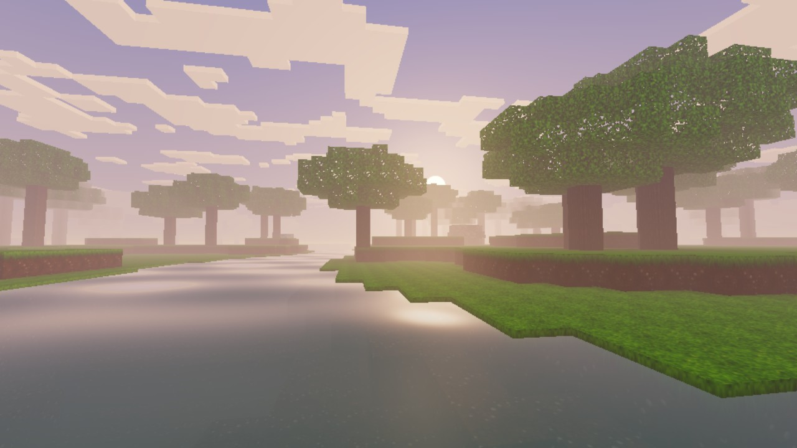
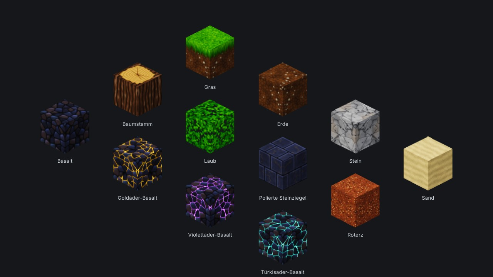

# Kantenhain

Voxel-Spiel für den mobilen Browser (WebGL2, ohne Abhängigkeiten) mit Shader-Grafik: Lichtstrahlen, Dunst, spiegelndes Wasser und gemalte Blocktexturen. Alle Texturen entstehen prozedural per Node-Script – es werden keine fremden Bilder verwendet.

## Starten

```
npm install
npm start            # baut Texturen + Server-Kern und startet http://localhost:8080
npm run build        # nur bauen (assets/tex*.bin, build/server.worker.js, server/dist/server.mjs)
npm run screenshots  # Vergleichsbilder Niedrig/Ultra (benötigt Playwright + Chromium)
```

Das Spiel ist eine rein statische Seite (`index.html`, `src/`, `assets/`, `build/`). Die gebauten Dateien sind eingecheckt, deshalb reicht für **GitHub Pages** „Deploy from a branch“ auf das Wurzelverzeichnis; für **Cloudflare Pages** das Repo verbinden, Build-Befehl leer lassen und als Ausgabeverzeichnis `/` wählen.

## Spielmodi

Beim Erstellen einer Welt wählst du den Modus; im Pausenmenü lässt er sich umschalten. Der Wechsel im Pausenmenü setzt „Cheats erlauben“ voraus. Spielmodus, Inventar, Leben, Hunger, Position und alle Blockänderungen werden pro Welt in IndexedDB gespeichert.

- **Kreativ:** unendlich Blöcke, Inventar mit Kategorien und Suche, sofort abbauen, kein Schaden. Fliegen per Doppeltipp auf Springen (Springen = hoch, Runter-Taste = sinken). Tageszeit im Menü frei einstellbar.
- **Survival:** 10 Herzen, 10 Keulen Hunger, Fallschaden, Ertrinken mit Luftanzeige. Abbauzeit je Block und Werkzeug, Blöcke fallen als Items. Werkzeuge aus Holz, Stein, Eisen und Diamant mit Haltbarkeit. 27 + 9 Slots, Stapel bis 64, Crafting 2×2 im Inventar und 3×3 an der Werkbank, Ofen zum Schmelzen. Nachts und in Höhlen Gegner (Schattenwicht, Höhlenkrabbler, Steinkoloss), tagsüber Tiere (Wollbock, Hüpfer). Beim Tod bleiben die Items liegen; das Bett setzt den Spawnpunkt und überspringt die Nacht.

Figuren und Item-Physik laufen mit festen 20 Ticks pro Sekunde, getrennt vom Rendern.

Rezepte (Auswahl): Stamm → 4 Bretter · 2 Bretter übereinander → 4 Stöcke · 2×2 Bretter → Werkbank · 8 Steine im Ring → Ofen · 3 Laub über 3 Brettern → Bett · Werkzeuge im üblichen Muster aus Material + Stöcken. Im Ofen: Eisenerz → Eisenbarren, rohes → gebratenes Fleisch, Stamm → Kohle.

## Steuerung (nur Querformat)

Das Spiel läuft ausschließlich im Querformat (PWA-Manifest `orientation: landscape`, `display: fullscreen`); hochkant pausiert es und bittet ums Drehen. Touch: Joystick links, rechts Tasten für Setzen/Benutzen, Abbauen/Angreifen (halten) und Springen, oben rechts Inventar und Menü, überall sonst wischen zum Umsehen. Am PC: WASD, Maus, Linksklick abbauen, Rechtsklick setzen/benutzen, E Inventar, 1–9/Mausrad für die Leiste, Leertaste doppelt = Fliegen, Shift = sinken, Strg = sprinten, M/Esc Menü.

## Befehle

Chat öffnen mit der Sprechblase (PC: T oder `/`). Tab vervollständigt, ↑/↓ blättern im Verlauf, bei falscher Syntax erscheint die richtige Verwendung. Befehle, die die Welt verändern, brauchen Operator-Rechte und „Cheats erlauben“ (beim Erstellen der Welt oder im Pausenmenü des Hosts).

`/help` · `/gamemode <survival|creative|spectator> [spieler]` · `/tp [ziel] <x y z | spieler>` · `/give <spieler> <item> [anzahl]` · `/clear [spieler] [item]` · `/time <set|add|query> [day|night|noon|midnight|zahl]` · `/weather <clear|rain|thunder> [sekunden]` · `/difficulty [peaceful|easy|normal|hard]` · `/gamerule <regel> [true|false]` · `/kill [ziel]` · `/summon <figur> [x y z]` · `/setblock <x y z> <block>` · `/fill <x1 y1 z1> <x2 y2 z2> <block>` · `/seed` · `/spawnpoint [spieler] [x y z]` · `/setworldspawn [x y z]` · `/effect <give|clear> <spieler> [effekt] [sekunden] [stufe]` · `/xp <add|set|query> <spieler> [menge] [points|levels]` · `/say` · `/kick` · `/op` · `/deop`

Koordinaten absolut oder relativ (`~ ~5 ~`), Ziele `@p @a @s @e` oder Spielername. Spielregeln: `keepInventory`, `doDaylightCycle`, `doMobSpawning`, `doWeatherCycle`, `fallDamage`, `mobGriefing` (wird gespeichert, hat aber noch keine Wirkung – Figuren verändern keine Blöcke). Figuren für `/summon`: `wicht`, `krabbler`, `koloss`, `bock`, `hupfer`. Effekte: `speed`, `jump_boost`, `regeneration`, `strength`, `resistance`, `instant_health`.

Dazu: Koordinaten in der Statuszeile, Debug-Anzeige (F3 oder Pausenmenü), vier Schwierigkeitsgrade, Wetter (Regen, Gewitter) und Erfahrung mit Leveln.

## Mehrspieler

Die Spiellogik läuft in einem autoritativen Server-Kern (`core/`, TypeScript ohne DOM). Derselbe Kern läuft im Web Worker (Einzelspieler und Host-Handy) und headless in Node.js (Dedicated Server). Der Client spricht immer dasselbe Binärprotokoll (`src/protocol.js`); nur der Transport wechselt: `postMessage`, WebRTC-DataChannel oder WebSocket. Gesendet werden nur Änderungen: Block-Deltas, lauflängenkomprimierte Chunks nach Sichtweite (ca. 3 kB statt 24 kB) und Positionen 10–15× pro Sekunde, die der Client glättet. Bewegung sagt der Client selbst voraus; Welt, Inventar, Leben und Figuren verwaltet der Server.

- **Für Mitspieler öffnen** (Pausenmenü): erzeugt Raumcode und QR-Code. Bis zu 4 Spieler treten per WebRTC bei; die Welt bleibt beim Host gespeichert. Dafür muss die Adresse eines Signaling-Dienstes eingetragen sein (siehe unten).
- **Beitreten** (Startbildschirm): Raumcode eingeben oder QR-Link öffnen – oder die Adresse eines Dedicated Servers.
- Jeder Spieler hat Namen, einfaches Aussehen (6 Farbsets), eigenes Inventar und den Chat.

Noch nicht enthalten: Splitscreen mit Gamepads.

## Server hosten

### 1. Signaling für Raumcodes (Cloudflare, kostenlos)

Der Dienst vermittelt nur den Verbindungsaufbau; die Spieldaten laufen danach direkt zwischen den Geräten (STUN: `stun.l.google.com`).

```
cd signaling/cloudflare
npx wrangler login
npx wrangler deploy        # ergibt https://kantenhain-signaling.<konto>.workers.dev
```

Im Spiel als Signaling-Dienst `wss://kantenhain-signaling.<konto>.workers.dev` eintragen. Ohne Cloudflare geht auch `npm run signaling` (Node, Port 8787) auf einem Rechner im WLAN: `ws://<ip>:8787` – das klappt nur, wenn auch das Spiel per `http://` geladen wird.

### 2. Dedicated Server (Node.js oder Docker)

```
npm install && npm run build:core
node server/dist/server.mjs server.config.json     # legt die Konfiguration beim ersten Start an
```

`server.config.json` (Beispiel in `server/server.config.example.json`): `port`, `maxPlayers`, `whitelist` (Liste oder `null`), `operators`, `worldName`, `seed`, `gamemode`, `cheats`, `viewDistance`, `worldFile`. In der Konsole gehen alle Befehle ohne `/`; `stop` speichert und beendet.

```
docker build -t kantenhain-server .
docker run -d --name kantenhain --restart unless-stopped -p 25580:25580 -v kantenhain-data:/data --memory=512m kantenhain-server
```

Das Image baut auf x86_64 und ARM64. Messung mit 8 simulierten, schnell laufenden Spielern: 3,4 ms pro Tick, 118 MB RAM.

**Oracle Cloud Free (ARM):** Instanz „VM.Standard.A1.Flex“ (Ubuntu) anlegen, Docker installieren (`sudo apt install docker.io`), Repo klonen und die beiden Docker-Befehle ausführen. Port 25580/TCP an zwei Stellen freigeben: in der Security List des Subnetzes und in der Instanz (`sudo iptables -I INPUT -p tcp --dport 25580 -j ACCEPT`, mit `netfilter-persistent save` dauerhaft).

**Günstiger VPS:** Docker installieren, dieselben Befehle; in der Firewall den Port öffnen (`sudo ufw allow 25580/tcp`).

**Wichtig bei HTTPS:** Eine per `https://` geladene Seite (GitHub Pages, Cloudflare Pages) darf nur `wss://` ansprechen. Dafür einen TLS-Proxy mit eigener Domain davor setzen, z. B. Caddy mit `spiel.example.org { reverse_proxy localhost:25580 }`, und im Spiel `wss://spiel.example.org` eintragen. Ohne Domain funktioniert `ws://<ip>:25580` nur, wenn das Spiel selbst per `http://` läuft (z. B. `npm start` im LAN) – und in der Android-App nicht.

## Android-App (Querformat)

`android/` enthält eine schlanke WebView-Hülle: Vollbild, fest im Querformat, ohne Internetzugriff – die Spieldateien liegen in der APK. Eine fertige Debug-APK liegt unter `dist/Kantenhain-debug.apk` (Android 8.0+, WebGL2 nötig).

```
cd android
ANDROID_HOME=/pfad/zum/android-sdk gradle assembleDebug   # -> app/build/outputs/apk/debug/app-debug.apk
```

Benötigt JDK 17+, Gradle 8.13+ sowie Android-SDK-Plattform 35 und Build-Tools 35. Für eine Veröffentlichung im Play Store ist ein Release-Build mit eigenem Signaturschlüssel nötig.

## Grafik

| | Niedrig | Mittel | Hoch | Ultra |
|---|---|---|---|---|
| Texturen (Texture-Array, Mipmaps, anisotrop) | 64 px | 64 px | 64 px | 128 px |
| Normal-Maps + Roughness | – | ✓ | ✓ | ✓ |
| Schatten (CSM, weiches PCF) | – | 1 Kaskade | 2 Kaskaden | 2 Kaskaden |
| Lichtstrahlen (radialer Blur) | – | ¼ Auflösung | ¼ Auflösung | ½ Auflösung |
| Bloom | – | – | ✓ | ✓ |
| Wasser | einfache Wellen | Normal-Map, Fresnel, Glitzer | + Refraktion | + Screen-Space-Reflections |
| Parallax-Mapping | – | – | – | ✓ |
| Gras-/Blumenbüschel (Radius) | – | 22 | 34 | 48 |
| Wolkenschichten | 1 | 1 | 2 | 2 |
| Sichtweite (Chunks) | 5 | 7 | 9 | 12 |

Immer aktiv: Höhen- und Distanznebel mit Sonnenstreuung, Smooth Lighting + Vertex-AO, ACES-Tonemapping, warme Farbkorrektur.

Bloom und Lichtstrahlen laufen in einem gemeinsamen Pass in reduzierter Auflösung; ohne Post-Effekte (Niedrig) wird direkt in den Framebuffer gezeichnet. Jeder Effekt ist im Menü einzeln abschaltbar. Die Auto-Qualität schaltet bei unter 40 FPS nacheinander ab: SSR → Lichtstrahlen → Schatten → Bloom, danach Parallax, Auflösung, Grasdichte.

## Screenshots (Niedrig / Ultra)

| Szene | Niedrig | Ultra |
|---|---|---|
| Wiese mit Hügeln und Wolken (Mittag) |  |  |
| Sumpf bei Sonnenaufgang |  |  |
| Waldsee mit Blumen im Gegenlicht |  |  |
| Block-Showcase |  |  |

Die Szenen lassen sich direkt öffnen: `index.html?scene=meadow|swamp|forest|showcase&q=low|medium|high|ultra` (mit `&shot=1` als feste Kamera ohne HUD).

## Aufbau

- `tools/gen-textures.mjs` – Textur-Generator (Farbe, Normal, Roughness, Höhe, Emissive je Block)
- `src/worldgen.js`, `src/mesher.js`, `src/worker.js` – Welt und Meshes im Web Worker
- `src/renderer.js`, `src/shaders.js` – Render-Pipeline
- `core/server.ts`, `core/commands.ts` – Server-Kern und Befehle; `core/worker.ts` (Browser), `server/index.ts` (Node)
- `src/client.js`, `src/net.js`, `src/protocol.js` – Client-Logik, Transporte, Binärprotokoll
- `signaling/` – Signaling-Dienst (Node und Cloudflare Worker)
- `src/entities.js`, `src/items.js`, `src/inventory.js` – Figuren, Items und Rezepte
- `src/storage.js` – Welten in IndexedDB
- `src/settings.js` – Qualitätsstufen, Einzelschalter, Auto-Qualität
