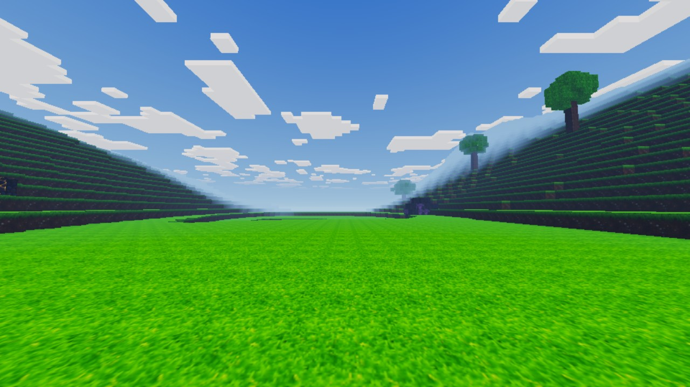
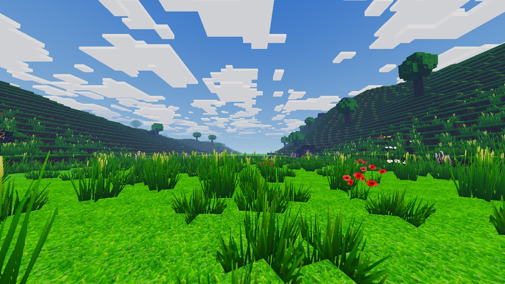
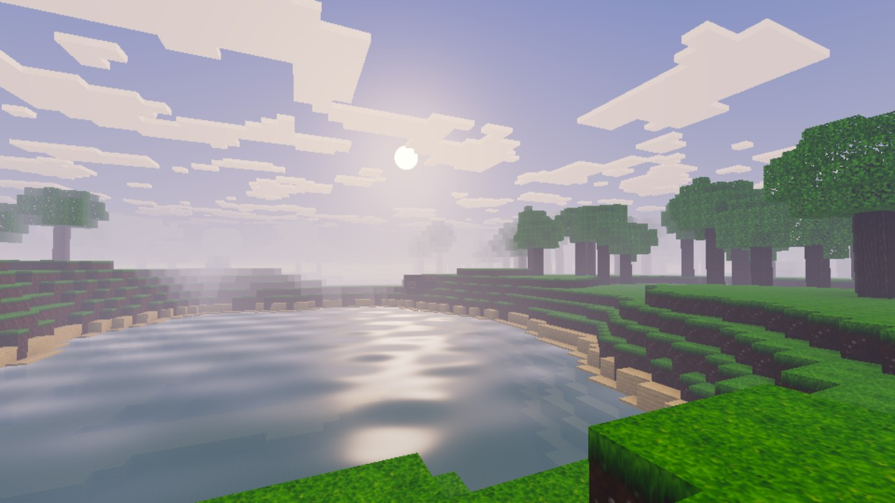
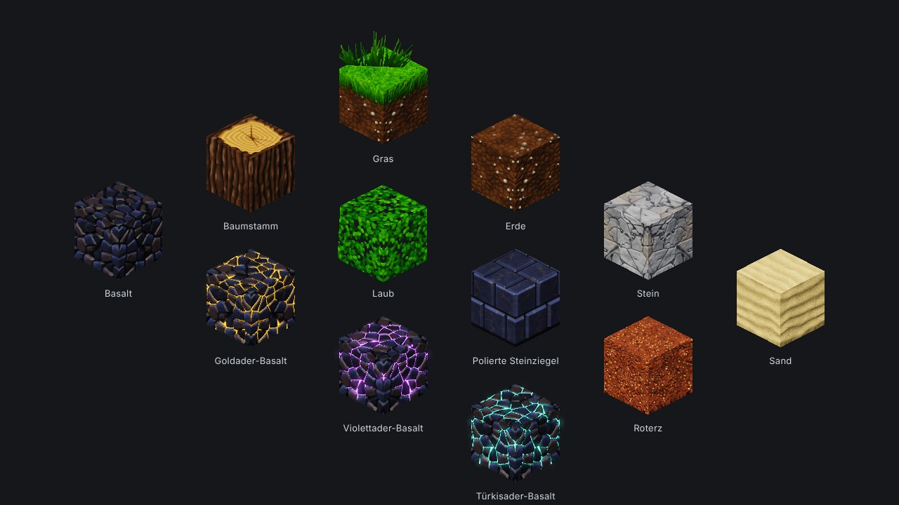

# Kantenhain

Voxel-Spiel für den mobilen Browser (WebGL2, ohne Abhängigkeiten) mit Shader-Grafik: Lichtstrahlen, Dunst, spiegelndes Wasser und gemalte Blocktexturen. Alle Texturen entstehen prozedural per Node-Script – es werden keine fremden Bilder verwendet.

## Starten

```
npm start          # erzeugt die Texturen und startet http://localhost:8080
npm run build      # nur Texturen neu erzeugen (assets/tex64.bin, assets/tex128.bin)
npm run screenshots  # Vergleichsbilder Niedrig/Ultra (benötigt Playwright + Chromium)
```

Das Projekt ist eine rein statische Seite (`index.html`, `src/`, `assets/`) und läuft auf jedem Static-Hosting.

## Spielmodi

Beim Erstellen einer Welt wählst du den Modus; im Pausenmenü lässt er sich umschalten. Spielmodus, Inventar, Leben, Hunger, Position und alle Blockänderungen werden pro Welt in IndexedDB gespeichert.

- **Kreativ:** unendlich Blöcke, Inventar mit Kategorien und Suche, sofort abbauen, kein Schaden. Fliegen per Doppeltipp auf Springen (Springen = hoch, Runter-Taste = sinken). Tageszeit im Menü frei einstellbar.
- **Survival:** 10 Herzen, 10 Keulen Hunger, Fallschaden, Ertrinken mit Luftanzeige. Abbauzeit je Block und Werkzeug, Blöcke fallen als Items. Werkzeuge aus Holz, Stein, Eisen und Diamant mit Haltbarkeit. 27 + 9 Slots, Stapel bis 64, Crafting 2×2 im Inventar und 3×3 an der Werkbank, Ofen zum Schmelzen. Nachts und in Höhlen Gegner (Schattenwicht, Höhlenkrabbler, Steinkoloss), tagsüber Tiere (Wollbock, Hüpfer). Beim Tod bleiben die Items liegen; das Bett setzt den Spawnpunkt und überspringt die Nacht.

Figuren und Item-Physik laufen mit festen 20 Ticks pro Sekunde, getrennt vom Rendern.

Rezepte (Auswahl): Stamm → 4 Bretter · 2 Bretter übereinander → 4 Stöcke · 2×2 Bretter → Werkbank · 8 Steine im Ring → Ofen · 3 Laub über 3 Brettern → Bett · Werkzeuge im üblichen Muster aus Material + Stöcken. Im Ofen: Eisenerz → Eisenbarren, rohes → gebratenes Fleisch, Stamm → Kohle.

## Steuerung (nur Querformat)

Das Spiel läuft ausschließlich im Querformat (PWA-Manifest `orientation: landscape`, `display: fullscreen`); hochkant pausiert es und bittet ums Drehen. Touch: Joystick links, rechts Tasten für Setzen/Benutzen, Abbauen/Angreifen (halten) und Springen, oben rechts Inventar und Menü, überall sonst wischen zum Umsehen. Am PC: WASD, Maus, Linksklick abbauen, Rechtsklick setzen/benutzen, E Inventar, 1–9/Mausrad für die Leiste, Leertaste doppelt = Fliegen, Shift = sinken, Strg = sprinten, M/Esc Menü.

## Android-App (Querformat)

`android/` enthält eine schlanke WebView-Hülle: Vollbild, fest im Querformat, ohne Internetzugriff – die Spieldateien liegen in der APK. Eine fertige Debug-APK liegt unter `dist/Kantenhain-debug.apk` (Android 8.0+, WebGL2 nötig).

```
cd android
ANDROID_HOME=/pfad/zum/android-sdk gradle assembleDebug   # -> app/build/outputs/apk/debug/app-debug.apk
```

Benötigt JDK 17+, Gradle 8.13+ sowie Android-SDK-Plattform 35 und Build-Tools 35. Für eine Veröffentlichung im Play Store ist ein Release-Build mit eigenem Signaturschlüssel nötig.

## Grafik

| | Niedrig | Mittel | Hoch | Ultra |
|---|---|---|---|---|
| Texturen (Texture-Array, Mipmaps, anisotrop) | 64 px | 64 px | 64 px | 128 px |
| Normal-Maps + Roughness | – | ✓ | ✓ | ✓ |
| Schatten (CSM, weiches PCF) | – | 1 Kaskade | 2 Kaskaden | 2 Kaskaden |
| Lichtstrahlen (radialer Blur) | – | ¼ Auflösung | ¼ Auflösung | ½ Auflösung |
| Bloom | – | – | ✓ | ✓ |
| Wasser | einfache Wellen | Normal-Map, Fresnel, Glitzer | + Refraktion | + Screen-Space-Reflections |
| Parallax-Mapping | – | – | – | ✓ |
| Gras-/Blumenbüschel (Radius) | – | 22 | 34 | 48 |
| Wolkenschichten | 1 | 1 | 2 | 2 |
| Sichtweite (Chunks) | 5 | 7 | 9 | 12 |

Immer aktiv: Höhen- und Distanznebel mit Sonnenstreuung, Smooth Lighting + Vertex-AO, ACES-Tonemapping, warme Farbkorrektur.

Bloom und Lichtstrahlen laufen in einem gemeinsamen Pass in reduzierter Auflösung; ohne Post-Effekte (Niedrig) wird direkt in den Framebuffer gezeichnet. Jeder Effekt ist im Menü einzeln abschaltbar. Die Auto-Qualität schaltet bei unter 40 FPS nacheinander ab: SSR → Lichtstrahlen → Schatten → Bloom, danach Parallax, Auflösung, Grasdichte.

## Screenshots (Niedrig / Ultra)

| Szene | Niedrig | Ultra |
|---|---|---|
| Wiese mit Hügeln und Wolken (Mittag) |  |  |
| Sumpf bei Sonnenaufgang |  |  |
| Waldsee mit Blumen im Gegenlicht |  |  |
| Block-Showcase |  |  |

Die Szenen lassen sich direkt öffnen: `index.html?scene=meadow|swamp|forest|showcase&q=low|medium|high|ultra` (mit `&shot=1` als feste Kamera ohne HUD).

## Aufbau

- `tools/gen-textures.mjs` – Textur-Generator (Farbe, Normal, Roughness, Höhe, Emissive je Block)
- `src/worldgen.js`, `src/mesher.js`, `src/worker.js` – Welt und Meshes im Web Worker
- `src/renderer.js`, `src/shaders.js` – Render-Pipeline
- `src/game.js`, `src/entities.js`, `src/items.js`, `src/inventory.js` – Spielregeln, Figuren, Items und Rezepte
- `src/storage.js` – Welten in IndexedDB
- `src/settings.js` – Qualitätsstufen, Einzelschalter, Auto-Qualität
